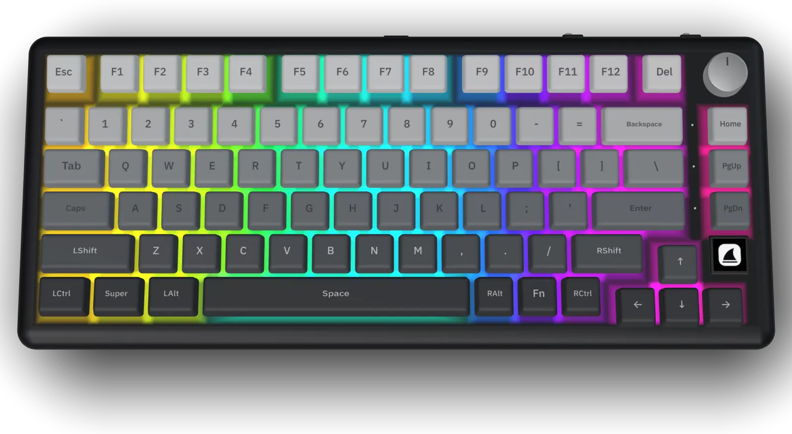
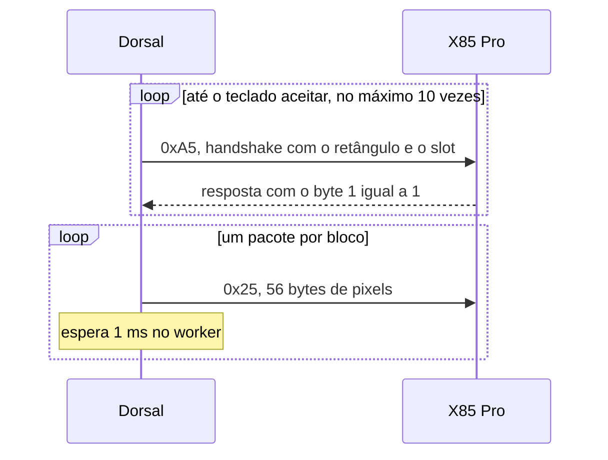
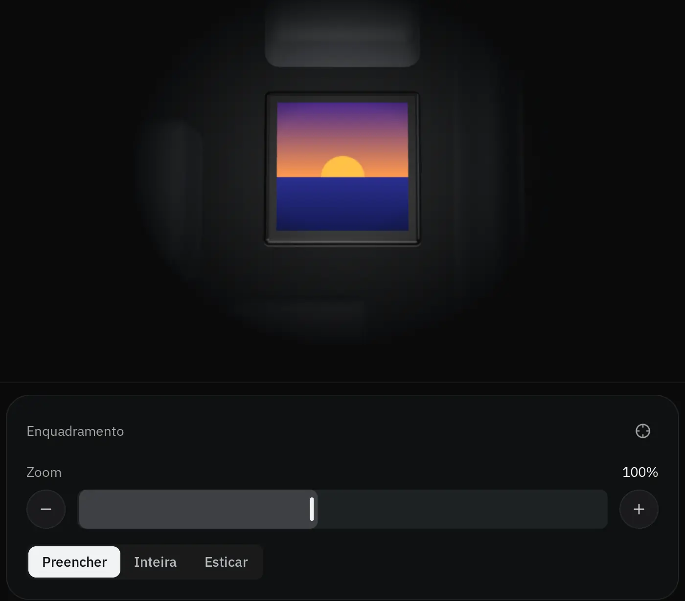
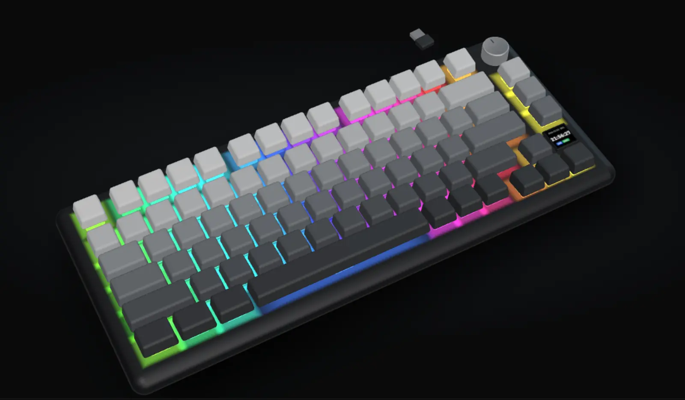
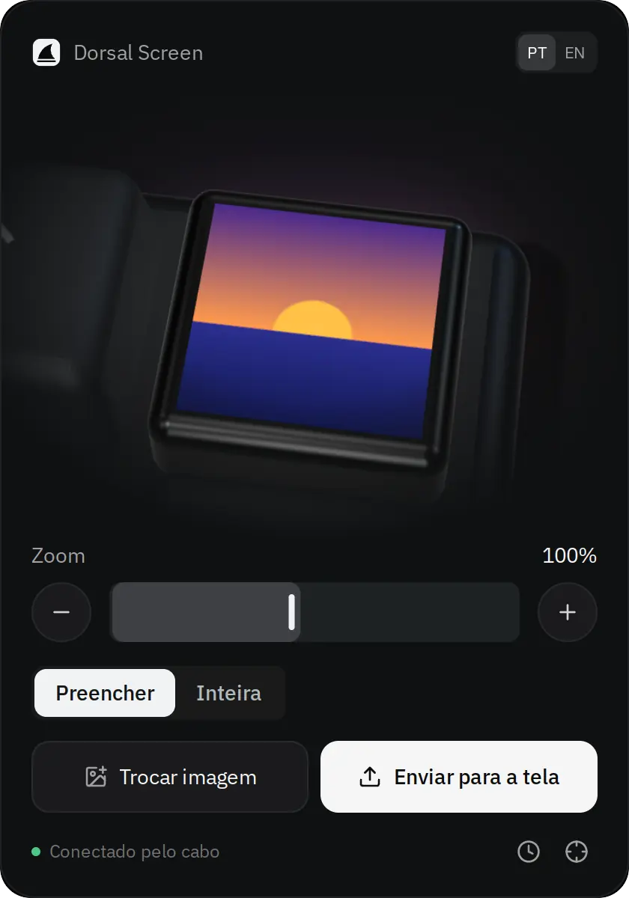

<figure class="post-figure">
  
  <figcaption>O X85 Pro em 3D no Dorsal, com o knob e a tela TFT</figcaption>
</figure>

O Attack Shark X85 Pro tem uma tela TFT, um knob e iluminação por tecla. Para configurar tudo isso existem dois caminhos oficiais: um executável de Windows e o site **qmk.top**, que fala com o teclado via WebHID.

No Linux, nenhum dos dois resolvia. O sistema só deixa o root abrir os dispositivos `hidraw`, e o firmware do X85 (ID **3451**) nem está no catálogo do site, então o editor da tela não aparece.

O [Dorsal](https://dorsal.cotoo.dev) nasceu disso: uma reimplementação independente do protocolo, entregue como site, AppImage e uma janela pequena só para a tela. Este texto trata do que foi preciso descobrir para chegar lá.

> [!NOTE]
> A engenharia reversa foi feita para interoperabilidade. Nenhum código proprietário foi copiado, e o protocolo está documentado em [`docs/protocol.md`](https://github.com/rouri404/dorsal/blob/main/docs/protocol.md).

## Por onde começar

O site oficial já falava com o teclado, então o bundle JavaScript dele era o melhor mapa disponível. Ele mostra quais comandos existem e como os pacotes são montados, mas ler o código não prova nada sobre o hardware.

Por isso a regra foi simples: **um comando só conta como conhecido depois de confirmado no teclado real**. Cada escrita foi lida de volta com o comando correspondente e depois desfeita. A luz e as teclas remapeadas também foram conferidas no olho e digitando.

O reset de fábrica é a exceção. O comando está mapeado, mas nunca foi executado nos testes.

## Um pacote de 64 bytes

A configuração passa pela interface 2 do teclado, usando apenas *feature reports* de 64 bytes, sem report ID. Quando existe resposta, ela é lida cerca de 10 ms depois.

Quase todo comando carrega um checksum simples:

```js
// at = 7 na maioria dos comandos, 8 nos de iluminação
function sign(packet, at) {
  let sum = 0;
  for (let i = 0; i < at; i++) sum += packet[i];
  packet[at] = 255 - (sum & 0xff);
}
```

Um detalhe ajudou bastante: comandos que o firmware não implementa voltam como um **eco** do pacote enviado. Isso separa "o teclado entendeu" de "o teclado só devolveu o que recebeu".

O dongle 2.4G expõe a mesma interface, mas responde zeros para todo comando de configuração. Por isso o Dorsal conversa apenas pelo cabo.

## Uma conversa por vez

O teclado prepara uma resposta de cada vez. Se dois comandos se intercalam, um pode ler a resposta do outro. A camada de transporte serializa todas as trocas, e um envio longo segura a fila inteira até terminar.

O problema menos óbvio apareceu com a janela em segundo plano. Navegadores limitam os timers da thread principal em abas ocultas a cerca de um disparo por segundo, e o envio da tela precisa de uma pausa de 1 ms entre pacotes.

| Onde as esperas rodam | Medição | Tempo |
| --- | --- | --- |
| Thread principal, janela oculta | 100 esperas de 1 ms | 97 s |
| Worker dedicado | 300 esperas de 1 ms | 0,34 s |

Mover as esperas para um worker resolveu, e um Web Lock impede que o navegador congele ou descarte a aba no meio do envio.

## Mandando uma imagem para a tela

O envio começa com um handshake (`0xA5`), repetido até 10 vezes, até o teclado responder que está pronto. Depois vêm os blocos de dados (`0x25`), com 56 bytes de pixels cada.

Os pixels vão em **RGB565 big-endian**, coluna por coluna, e somente dentro do retângulo que contém pixels não pretos. Em animações, esse retângulo é a união dos retângulos de todos os quadros.



<figure class="post-figure">
  
  <figcaption>O editor enquadra a imagem na própria tela do modelo 3D antes do envio</figcaption>
</figure>

## O que só o hardware conta

A parte mais interessante foi o que o código do fabricante não dizia. As animações por tecla aceitam até 200 quadros, e o primeiro envio longo tocou todos eles. Nos seguintes, os quadros depois de mais ou menos o centésimo ainda guardavam dados de envios anteriores.

O comando de início não apaga a área inteira. Um teste com quadros todos brancos deixou o limite visível:

| Quadros | No teclado |
| --- | --- |
| 100 | Tocaram limpos |
| 160, 167 e 170 | Piscaram no fim de cada ciclo |
| 200 | Mostraram parte da animação antiga |

A correção foi aceitar o limite real: o Dorsal usa **no máximo 100 quadros**, de 20 a 130 ms cada. O mesmo efeito em 100 quadros de 40 ms levou 9,6 s para gravar e tocou limpo.

<figure class="post-figure">
  
  <figcaption>O estúdio de efeitos grava as animações no teclado, que passa a tocá-las sozinho</figcaption>
</figure>

## Uma janela só para a tela

Muita gente só quer trocar a imagem do teclado. Para isso existe o **Dorsal Screen**, uma janela pequena que usa o mesmo editor, mas não lê as outras configurações, então abre mais rápido.

<figure class="post-figure is-narrow">
  
  <figcaption>O Dorsal Screen, com o mesmo código do configurador</figcaption>
</figure>

## O que ficou de fora

Macros e atualização de firmware ficaram de fora de propósito. Um erro nessas áreas pode brickar o teclado, e nenhum recurso vale esse risco no equipamento de quem confiou na ferramenta.

## O que aprendi

- **O código diz o que deveria acontecer, e o hardware diz o que acontece.** O limite de quadros só apareceu testando no teclado.
- **Ler de volta é o teste mais barato.** Escrever, ler e desfazer deu confiança para mexer em um dispositivo sem documentação.
- **Documentar enquanto descobre vale a pena.** O `protocol.md` separa o que foi confirmado do que só foi lido no código, e isso evita tratar suposição como fato.

O código está em [github.com/rouri404/dorsal](https://github.com/rouri404/dorsal), e o configurador roda em [dorsal.cotoo.dev](https://dorsal.cotoo.dev). Sem o teclado em mãos, `?demo` no endereço repete respostas reais de um X85 Pro.
