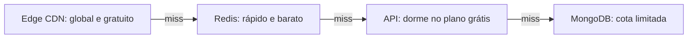
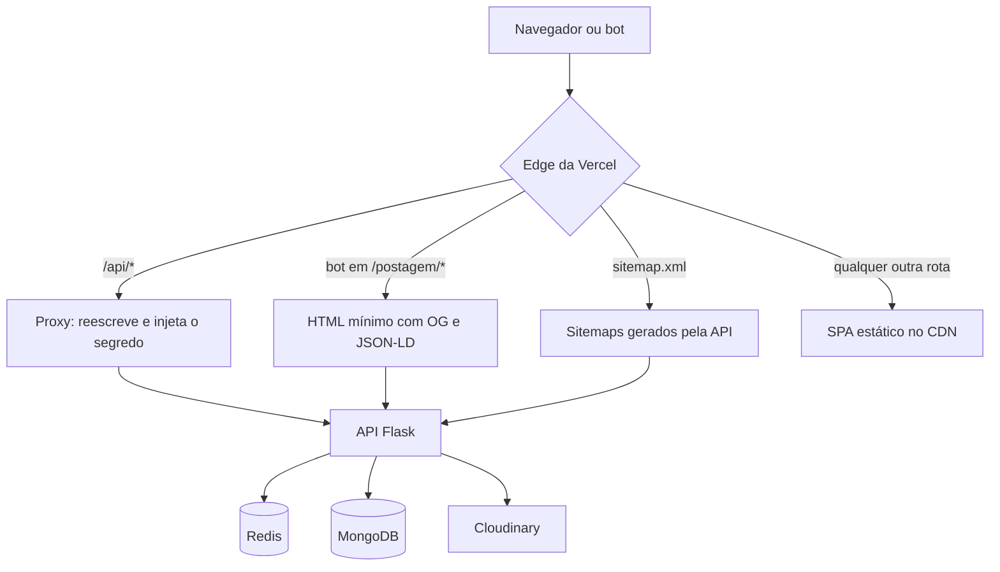
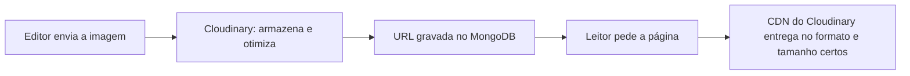
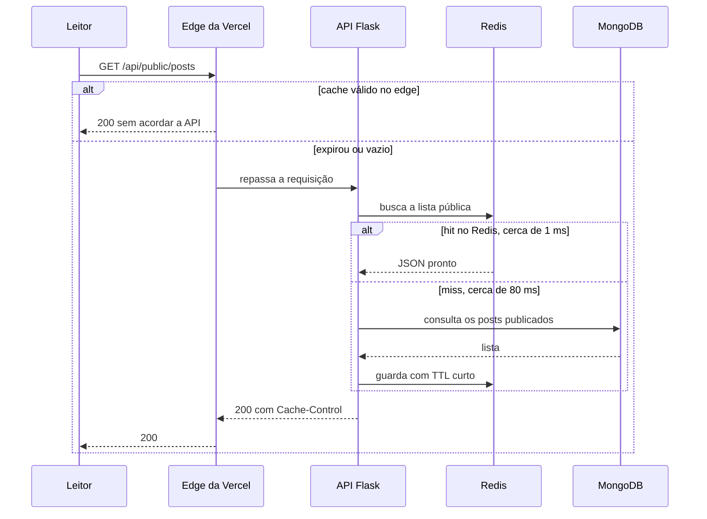
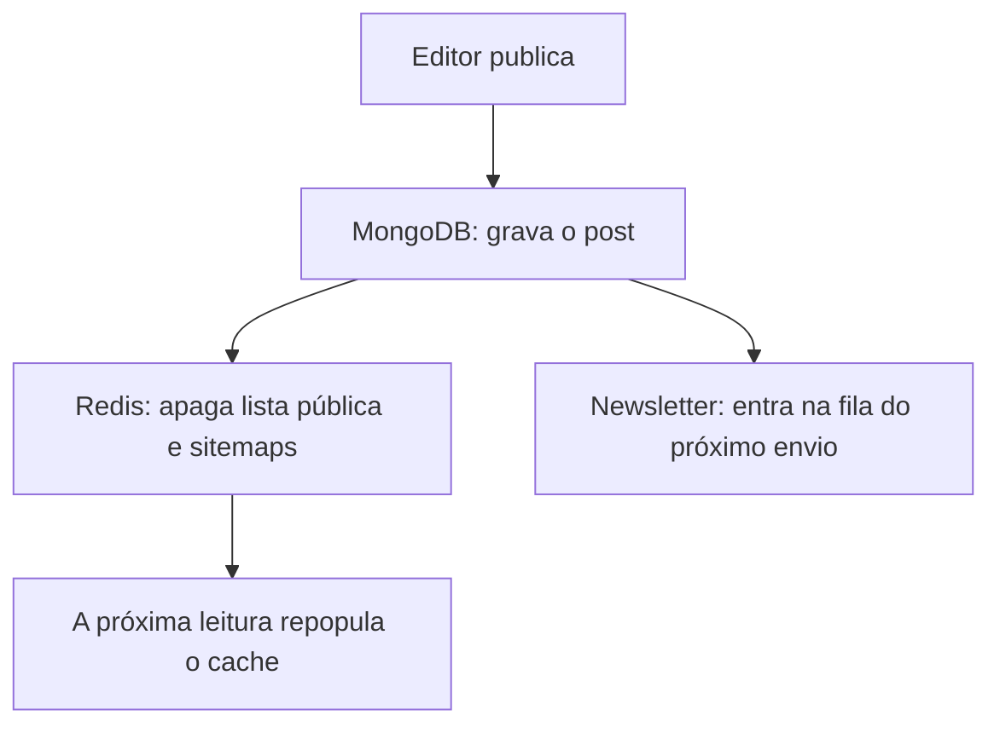
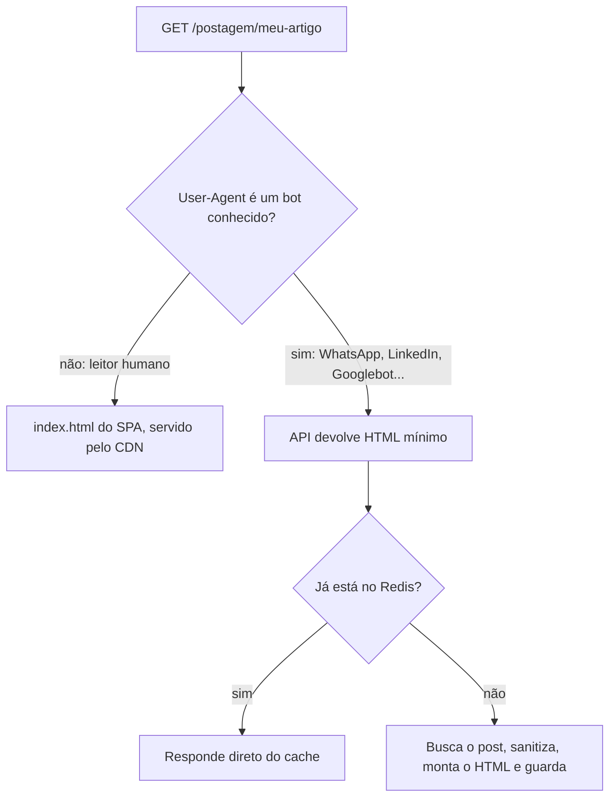
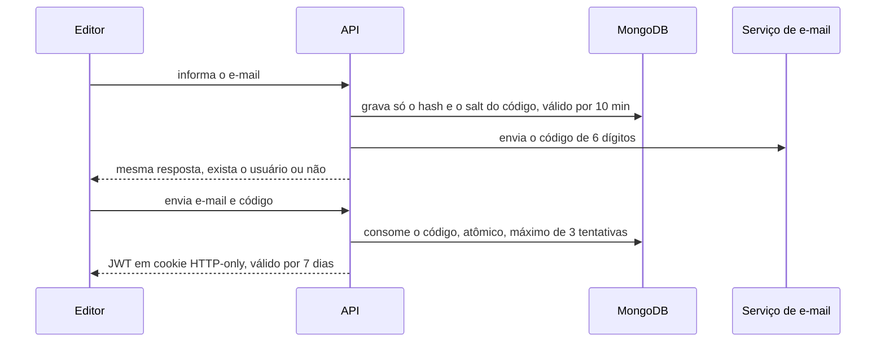
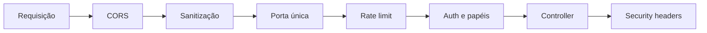

Um grupo de pesquisadores do IFCH/Unicamp precisava de um **portal editorial** para o Observatório da Extrema Direita Latino-Americana (OEDLA): artigos, análises eleitorais, produção científica e notícias. A equipe publica sozinha, e os leitores chegam, em boa parte, por links compartilhados em redes sociais.

O requisito que mais pesou não estava na lista de funcionalidades: **custo**. O OEDLA é um projeto acadêmico, sem verba mensal para servidor, banco, CDN ou e-mail. A meta era uma infraestrutura de **R$ 0** que não fosse lenta, frágil nem insegura, e é assim que ele roda hoje, no ar em [oedla.ifch.unicamp.br](https://oedla.ifch.unicamp.br).

Cache em camadas, proxy com segredo, roteamento por User-Agent e rate limit existem por causa dessa meta. Este texto trata das **decisões de arquitetura**, não do código.

> [!NOTE]
> Fiz o projeto junto com meu querido amigo **Pedro Graciani**, então o "nós" do texto é literal. Agradeço pela oportunidade de construir o OEDLA.

---

## O problema

Antes de escolher qualquer tecnologia, escrevemos o que o sistema precisava fazer:

- **Leitores** acessam artigos rápido, em qualquer celular, sem criar conta.
- **Editores** publicam sozinhos, sem depender de um desenvolvedor.
- **Links compartilhados** no WhatsApp, LinkedIn e Telegram mostram título, resumo e imagem corretos.
- **Google** indexa tudo direito, porque um observatório vive de ser encontrado.
- **Custo:** planos gratuitos de hospedagem, banco e cache.

O último item moldou todo o resto. Com infraestrutura gratuita, cada decisão de arquitetura vira uma conversa sobre o que é desligado quando ninguém está olhando.

---

## O verdadeiro requisito: custo

Planos gratuitos não são versões pequenas de planos pagos. Eles têm **comportamentos** que quebram suposições comuns:

| Limitação do plano gratuito | O que acontece | Decisão de arquitetura |
| :--- | :--- | :--- |
| **API que dorme** | A primeira requisição depois de um tempo parado demora muito (estimamos 30 a 60 s) | Cache no edge com revalidação em segundo plano, e o frontend tenta de novo com paciência |
| **Banco com cota** | Cada leitura consome um recurso limitado | Cache-aside no Redis: o banco só é consultado em miss |
| **Redis com pouca memória** | Pode ficar sem espaço e recusar operações | Rate limiter e cache **falham de forma aberta**, com TTLs curtos |
| **Purge de CDN só por tag** | A Vercel invalida o cache por tag (`Vercel-Cache-Tag`), não por URL, e isso exigiria marcar as respostas e chamar a API de purge a cada publicação | TTL curto com revalidação em segundo plano, sem purge |
| **Sem agendador gratuito** | Não há cron job para a newsletter | Um workflow agendado do GitHub Actions faz o papel de cron |
| **Sem servidor de renderização** | SPA entrega HTML vazio para bots | Roteamento por User-Agent no edge, devolvendo um HTML mínimo |
| **API pública na internet** | Qualquer um pode acordar e martelar o servidor | Porta única: só o nosso proxy fala com a API, mais rate limit por IP |

A regra que guiou tudo foi: **a requisição mais barata é a que nunca chega ao servidor**. Cada camada responde antes da seguinte, que é sempre mais cara, mais lenta ou mais limitada.

O domínio é um subdomínio da própria universidade. O único custo real do projeto é **tempo de engenharia**.

---

## A stack, em uma linha

Flask na API, React no frontend, MongoDB, Redis e Cloudinary, com a Vercel hospedando o frontend e o Render hospedando a API e o Redis. Nada exótico: o ganho de custo vem de **como as peças se conectam**.

A escolha mais debatida foi o **SPA com React**. Num portal de notícias, SEO e pré-visualização de links são críticos, e SPA puro sofre nisso. Voltamos a esse ponto adiante, porque é a parte mais interessante do projeto.

---

## Arquitetura: o edge como porta de entrada

O **navegador só conversa com um domínio**, o do site. A Vercel serve o frontend estático, sem custo de servidor, e um middleware e regras de rewrite no edge decidem para onde cada requisição vai:

Esse roteamento resolve três problemas **sem servidor extra**:

1. **Proxy.** O frontend chama `/api/...` no próprio domínio. O middleware reescreve para a API real e acrescenta um segredo que só ele conhece, e o endereço da API nem aparece no navegador.
2. **Roteamento por User-Agent.** Bots de pré-visualização recebem uma página diferente do SPA (detalhes adiante).
3. **Sitemaps.** O `sitemap.xml` parece estar no domínio do site, mas é gerado pela API.

O backend segue uma separação simples em camadas (rotas, regras de negócio, acesso a dados e serviços externos). Nada de novo, e isso é intencional: num projeto que outras pessoas vão manter, **previsível vence esperto**.

---

## Banco e mídia: guardar pouco, servir de longe

**Banco.** Usamos o MongoDB Atlas no plano gratuito, com pouco armazenamento e uma cota de operações. Um post é basicamente um documento (título, slug, corpo, tags, status, datas, imagem de capa), e o formato flexível permite adicionar um campo sem rodar migration. Tratamos o banco como **fonte da verdade, e não como fonte de leitura**: quem serve a vitrine pública é o cache. Também mantemos os documentos enxutos e indexamos o que as consultas usam (slug e status com data de publicação), porque, numa cota limitada, um `find` sem índice é desperdício.

**Imagens.** O peso da página está nas imagens. O disco de um serviço gratuito é efêmero, e servir imagem pela API acordaria o servidor à toa. Por isso o upload vai para o **Cloudinary**, que armazena o arquivo e o entrega por CDN. No MongoDB ficam só a URL e o identificador da imagem, nunca o binário.

O Cloudinary também transforma a imagem **pela própria URL**, então pedimos o que precisamos na hora:

- `f_auto` entrega WebP ou AVIF quando o navegador suporta, e JPEG como fallback.
- `q_auto` ajusta a compressão sem estragar a imagem.
- `w_800` (ou outra largura) redimensiona, e o celular não baixa uma foto de 4000 px.

O mesmo mecanismo gera a **imagem de pré-visualização**: o `og:image` aponta para uma URL já recortada no tamanho que WhatsApp e LinkedIn esperam.

> [!NOTE]
> O plano gratuito do Cloudinary também tem cota (armazenamento e transformações). Pedir poucas variações de tamanho e deixar o CDN cachear cada uma mantém o consumo baixo.

---

## Cache em três camadas

A vitrine pública é *read-heavy*: milhares de leituras para cada publicação. Como a API dorme e o banco tem cota, o cache aqui não é otimização, é **o que mantém o projeto de pé sem pagar por mais servidor**.

1. **Edge da Vercel.** Os endpoints públicos respondem com `Cache-Control: public, s-maxage=…, stale-while-revalidate=…`. Enquanto o cache é válido, a requisição nem chega à API. Depois que expira, o leitor ainda recebe a versão anterior enquanto a nova é buscada em segundo plano.
2. **Redis em cache-aside.** O Redis roda no Render, junto da API. A API consulta o Redis; se não achar, consulta o MongoDB e guarda o resultado com TTL curto.
3. **Invalidação na escrita.** Toda criação, edição ou remoção de post apaga as chaves relevantes no Redis (lista pública e sitemaps). Não invalidamos o edge da Vercel ao publicar: o purge dela é por tag, e a API ainda não marca as respostas nem chama a API de purge. O frescor no edge depende só do TTL, então logo após uma publicação a vitrine pode mostrar a versão anterior por alguns minutos (o `s-maxage` é de 1 minuto na listagem e de 5 minutos no post e nos sitemaps).

O `stale-while-revalidate` foi a decisão mais útil. Ele troca "dado sempre fresco" por "dado quase sempre instantâneo", e para um observatório essa é a troca certa.

> [!WARNING]
> Cache e erro não combinam. Respostas de erro saem sempre com `no-store`. Um 429 ou 403 cacheado no edge seria servido a todo mundo por minutos, transformando um limite individual numa queda coletiva.

---

## O problema do SPA: WhatsApp não executa JavaScript

Num SPA, o servidor entrega um `index.html` vazio e o React monta a página no navegador. Para um humano, funciona. Para o **crawler do WhatsApp**, que lê só o HTML bruto, a página não tem título, resumo nem imagem, e o link compartilhado vira um retângulo sem graça.

O caminho "padrão" seria trocar para um framework com SSR, ou seja, **um servidor renderizando páginas o tempo todo**, que um orçamento zero não comporta. Resolvemos com roteamento, no que o Google chama de *dynamic rendering*:

- Uma regra de rewrite no edge olha o **User-Agent**. Se for um bot conhecido (WhatsApp, Telegram, LinkedIn, Discord, Slack, Googlebot, Bingbot e afins), a requisição é reescrita para uma rota da API.
- Essa rota devolve um HTML mínimo com título, descrição, imagem, tag canônica, **JSON-LD** e o corpo do artigo.
- Humanos continuam recebendo o SPA.

O SPA continua estático, e a API só trabalha quando um bot pede uma página, e ainda assim com o resultado em cache. Duas decisões decorrem disso:

- **Edge cache e User-Agent não combinam.** Se o CDN cacheasse a resposta do bot, ela poderia ser servida a um humano. Por isso as páginas de postagem não são cacheadas na borda, e o HTML dos bots fica no Redis.
- **O bot precisa ver o que o humano vê.** Mostrar outra coisa é *cloaking*, e o Google penaliza. O bot recebe o artigo real, só que sem o JavaScript em volta.

Os sitemaps (inclusive o de notícias, só com publicações recentes) também saem da API e são reescritos para o domínio do site.

---

## Autenticação sem senha

Os editores entram com **OTP por e-mail**, um código de 6 dígitos de uso único:

Sem senha, não há armazenamento de senhas, fluxo de "esqueci minha senha" nem provedor de identidade pago. A resposta do pedido de login é sempre a mesma, exista o e-mail ou não, e cada usuário tem uma única sessão ativa por vez.

---

## Segurança em camadas

Uma API pública recebe lixo desde o primeiro dia. Em infraestrutura gratuita isso dói duas vezes, porque cada requisição indevida **acorda o servidor e gasta cota**. Em vez de uma defesa única, montamos várias camadas pequenas, executadas em ordem a cada requisição:

**Porta única.** A API só aceita tráfego que venha do nosso proxy. O middleware injeta um segredo compartilhado ao reescrever `/api/*`, e a API rejeita o resto, com exceção de uma lista explícita de rotas públicas (health check, sitemaps e páginas para bots).

**Rate limit que não confia em cabeçalho forjado.** Limitar por IP é fácil; saber qual é o IP *de verdade* atrás de CDN e load balancer é o difícil. Só confiamos no IP encaminhado pelo proxy quando a requisição prova que veio dele, e agrupamos IPv6 por /64, porque senão bastaria trocar de endereço dentro do mesmo bloco para escapar do limite.

**Falha aberta onde dá, fechada onde importa.** Se o Redis cair ou ficar sem memória, o rate limiter libera o acesso e o cache é ignorado: o site fica mais lento, mas não cai. A autenticação e a porta única nunca fazem isso.

**Newsletter com double opt-in.** Quem se inscreve confirma por e-mail antes de entrar na lista, e o formulário tem reCAPTCHA. Isso evita queimar a cota gratuita de envio com endereços falsos ou abusivos.

---

## O que aprendemos

1. **Uma restrição de orçamento no início melhora o desenho.** Tratar cada requisição como algo que tem preço nos forçou a resolver problemas que a folga de orçamento teria escondido.
2. **Cache e frescor se desenham juntos.** Sem invalidação ativa, o TTL passa a ser a promessa de frescor do site, e escolhê-lo é uma decisão de produto, não só de performance.
3. **O edge é a peça mais subestimada.** Proxy, roteamento por User-Agent e reescrita de sitemaps resolveram, de graça, o que normalmente pediria um servidor de renderização.
4. **Dynamic rendering tem custo de manutenção.** Ele cria uma segunda forma de renderizar cada página, e as duas precisam ficar sincronizadas.
5. **Se uma decisão de segurança depende de um header, pergunte quem consegue forjá-lo.**

Se você chegou até aqui, obrigado por ler. Se estiver montando algo parecido e quiser trocar ideia, fale com a gente.

---

## Apêndice: quanto isso aguenta? (estimativas)

> [!WARNING]
> Tudo abaixo são **estimativas de ordem de grandeza**, a partir de latências típicas de rede, dos limites dos planos gratuitos e de uma taxa de acerto de cerca de **93%** no cache de borda. Nada vem de teste de carga.

Premissas: leitor no Brasil, 130 ms de ida e volta até os EUA, 15 ms até São Paulo e 12 ms até o edge da Vercel e até o CloudFront. Comparamos três montagens:

- **Nossa solução:** Vercel + Render (EUA) + Redis + MongoDB, tudo em plano gratuito.
- **AWS em São Paulo:** CloudFront + ALB + EKS + ElastiCache + DynamoDB em `sa-east-1`.
- **AWS na Virgínia:** a mesma pilha em `us-east-1`.

### 1. Latência

| Montagem | Sem cache | Com Redis | Com cache no edge |
| :--- | :-: | :-: | :-: |
| **Nossa solução** (Render nos EUA) | ~300 ms | ~260 ms | **~40 ms** |
| AWS `sa-east-1` | ~80 ms | ~70 ms | ~40 ms |
| AWS `us-east-1` | ~420 ms | ~410 ms | ~40 ms |

Na nossa solução, estimamos que 93% das leituras caiam na última coluna e 7% na do meio, o que dá uma média de **~55 ms** (0,93 × 40 + 0,07 × 260).

- **O cache no edge iguala tudo em ~40 ms**, não importa onde a API esteja.
- **O Redis ganha só 10 a 40 ms.** Ele protege a cota do banco, e não acelera o leitor.
- **Sem edge, a distância domina:** a API na Virgínia (~410 ms) é 6 vezes mais lenta que em São Paulo (~70 ms).

Chamar o Render direto, sem o proxy da Vercel, custa ~450 ms. A primeira requisição com a API dormindo leva **30 a 60 s**, e a AWS não tem cold start.

### 2. Custo mensal

| Item | `sa-east-1` | `us-east-1` |
| :--- | :-: | :-: |
| EKS (control plane) | US$ 73 | US$ 73 |
| 2 nós `t3.medium` | US$ 98 | US$ 61 |
| NAT Gateway | US$ 68 | US$ 33 |
| ALB | US$ 25 | US$ 22 |
| ElastiCache `t3.micro` | US$ 20 | US$ 12 |
| CloudFront, DNS e tráfego | US$ 15 | US$ 10 |
| DynamoDB (sob demanda) | US$ 8 | US$ 5 |
| **Total AWS** | **~US$ 310 (R$ 1.650)** | **~US$ 220 (R$ 1.200)** |
| **Nossa solução** | **R$ 0** | **R$ 0** |

Com réplica de Redis e um terceiro nó para alta disponibilidade, a AWS sobe mais 30 a 40%. Usamos DynamoDB por ser o banco nativo e cobrar por uso, mas ele exige reescrever a camada de dados (chaves e índices definidos de antemão, sem consultas livres como no Mongo).

### 3. Capacidade

Premissa: cada leitor faz 1 requisição de API a cada 10 s.

| Montagem | Usuários simultâneos |
| :--- | :-: |
| Nossa solução, sem cache | 100 a 150 |
| Nossa solução, só Redis | 400 a 600 |
| **Nossa solução, Redis + edge** | **milhares** |
| AWS, 2 nós + Redis | 2.000 a 4.000 |
| AWS, com CloudFront | dezenas de milhares |

Com ~93% de acerto no edge, uma API que aguenta 50 req/s atende o equivalente a ~700 req/s de leitura (50 ÷ 0,07). O limite passa a ser a banda do CDN, e não a API.

### 4. Conclusão

- **Para o leitor, o resultado é o mesmo:** ~40 ms em qualquer montagem com cache no edge.
- **A AWS compra o que o plano grátis não dá:** sem cold start, com SLA, escala horizontal e CPU previsível.
- **O preço é R$ 1.200 a R$ 1.650 por mês**, contra R$ 0 do cache no edge para o mesmo tempo de resposta.

> [!NOTE]
> Preços sob demanda estimados a partir das tabelas públicas da AWS, sem impostos e sem câmbio exato. Confira no AWS Pricing Calculator antes de decidir. Para trocar as estimativas por dados reais, use `curl -w` (`time_starttransfer`, miss contra hit) e `k6` ou `hey` para carga.
