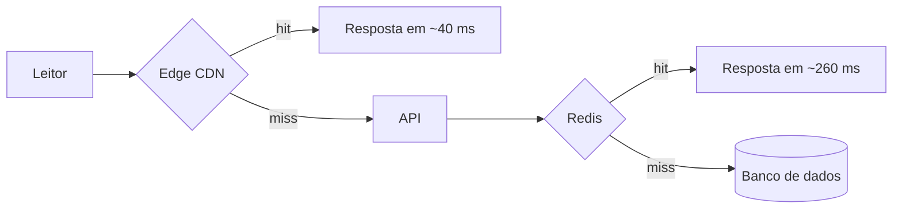
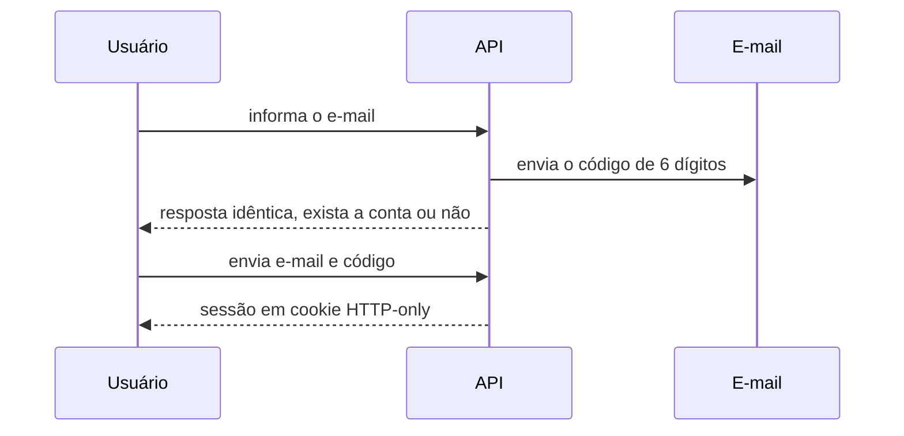

## Introdução

Este é um post de demonstração para testar todos os elementos visuais, blocos de código, tabelas, diagramas, imagens e alertas disponíveis na renderização do blog.

Ele também serve para validar a navegação de leitura: o sumário lateral (`// nesta página`) e os títulos que ficam fixos no topo enquanto você rola cada seção.


---

## Alertas do GitHub (Callouts)

Abaixo estão os cinco tipos de alertas disponíveis, estilizados com ícones em pixel art:

> [!NOTE]
> Esta é uma **Nota** de esclarecimento. Use para informações contextuais que auxiliam na compreensão do conteúdo.

> [!TIP]
> Esta é uma **Dica** útil. Dicas práticas ajudam os desenvolvedores a otimizar seu fluxo diário de trabalho.

> [!IMPORTANT]
> Este é um aviso **Importante**. Informações cruciais que afetam o resultado das operações devem ser destacadas assim.

> [!WARNING]
> Este é um **Aviso** de atenção. Sinaliza armadilhas comuns, comportamentos inesperados ou pré-requisitos não atendidos.

> [!CAUTION]
> Este é um alerta de **Cuidado**. Use para advertir sobre riscos de perda irreversível de dados, brechas ou falhas graves.

### Alertas com conteúdo rico

Os alertas aceitam mais de um parágrafo, listas e código inline:

> [!IMPORTANT]
> Antes de rodar `docker system prune -a`, confirme:
>
> - que nenhum container importante está parado;
> - que você tem backup dos volumes que não podem ser perdidos;
> - que o comando será executado no ambiente certo.
>
> Depois disso, o comando é seguro.

---

## Blocos de Código e Copiar Comandos

Cada bloco de código exibe a linguagem no cabeçalho e possui um botão retrô para copiar comandos.

### Shell

```bash
# Atualizar repositórios e instalar dependências
sudo apt update && sudo apt upgrade -y
curl -fsSL https://get.docker.com | sh   # Script oficial de instalação
sudo usermod -aG docker $USER            # Permissão sem sudo
```

### JavaScript

```javascript
// Exemplo de debounce em JavaScript vanilla
function debounce(fn, delay = 200) {
  let timer;
  return function (...args) {
    clearTimeout(timer);
    timer = setTimeout(() => fn.apply(this, args), delay);
  };
}
```

### Python

```python
# Contador de palavras com tratamento de erro
from collections import Counter

def top_words(path: str, n: int = 5) -> list[tuple[str, int]]:
    with open(path, encoding="utf-8") as f:
        words = f.read().lower().split()
    return Counter(words).most_common(n)
```

### YAML

```yaml
version: "3.8"
services:
  web:
    image: nginx:alpine
    ports:
      - "8080:80"
    restart: always
```

### JSON e SQL

```json
{
  "name": "cotoo.dev",
  "private": true,
  "scripts": { "dev": "vercel dev" }
}
```

```sql
-- Posts publicados nos últimos 30 dias
SELECT slug, title, published_at
FROM posts
WHERE status = 'published'
  AND published_at >= NOW() - INTERVAL '30 days'
ORDER BY published_at DESC;
```

---

## Diagramas Mermaid

Os diagramas seguem o tema e só são desenhados quando se aproximam da tela. O botão **código** mostra o texto-fonte.

### Fluxograma



### Diagrama de sequência



---

## Imagens e Mídia

As imagens são responsivas e adaptadas ao layout centralizado:


---

## Tabelas

As tabelas contam com barra de rolagem horizontal responsiva quando necessário.

### Tabela comparativa

| Comando | Descrição | Escopo |
| :--- | :--- | :--- |
| `docker run` | Cria e inicia um novo container | Instância |
| `docker ps -a` | Lista todos os containers locais | Sistema |
| `docker compose up` | Sobe múltiplos serviços coordenados | Orquestração |
| `docker system prune` | Remove recursos órfãos e limpa disco | Manutenção |

### Alinhamento de colunas

| Serviço | Latência (ms) | Disponibilidade |
| :--- | :---: | ---: |
| Edge CDN | 40 | 99,99% |
| Redis | 260 | 99,9% |
| API sem cache | 300 | 99,5% |

### Tabela larga

Quando há muitas colunas, a tabela rola na horizontal sem quebrar o layout da página:

| Região | Provedor | Plano | CPU | Memória | Disco | Rede | Custo/mês | Observações |
| :--- | :--- | :--- | :---: | :---: | :---: | :---: | ---: | :--- |
| `us-east-1` | AWS | Sob demanda | 2 vCPU | 4 GB | 50 GB | 5 Gbps | US$ 220 | Mais barata da AWS |
| `sa-east-1` | AWS | Sob demanda | 2 vCPU | 4 GB | 50 GB | 5 Gbps | US$ 310 | Menor latência no Brasil |
| `oregon` | Render | Gratuito | 0,1 vCPU | 512 MB | Efêmero | Compartilhada | R$ 0 | Dorme após inatividade |

---

## Citações

Uma citação comum, sem tipo de alerta, aparece com a barra lateral:

> A requisição mais barata é a que nunca chega ao servidor.

Citações também podem ter vários parágrafos e formatação:

> Cache não é uma otimização, é **arquitetura**.
>
> Desenhe o caminho de invalidação junto com o de leitura e você evita uma classe inteira de problemas.

---

## Listas e Formatações

### Listas simples e aninhadas

- Item de lista com texto em **negrito** e *itálico*.
- Suporte a comandos inline como `docker ps` e links externos como [Docker Docs](https://docs.docker.com).
- Subitens aninhados:
  - Nível 2 com informação detalhada.
  - Outro detalhe com código `npm run build`.
    - Nível 3 para hierarquias mais profundas.

### Listas numeradas

1. Primeiro passo da execução.
2. Segundo passo com validação de saída.
   1. Subpasso com verificação manual.
   2. Subpasso com verificação automática.
3. Terceiro passo com conclusão bem-sucedida.

### Texto inline

Combinações de **negrito**, *itálico*, ***negrito e itálico***, ~~texto riscado~~ e `código inline` funcionam dentro de parágrafos, listas, tabelas e alertas.

Links externos abrem em nova aba, como [a documentação do Mermaid](https://mermaid.js.org), e links internos levam a outras páginas, como o [índice do blog](/blog/).

#### Título de nível 4

Os títulos `h4` também são estilizados, mas não aparecem no sumário nem ficam fixos. Servem para dividir blocos pequenos dentro de uma seção.

---

## Conclusão

Se todos os componentes acima renderizam corretamente nos temas claro e escuro, em modo Pixel e modo Leitura, e em telas pequenas, a página está pronta para receber conteúdo real.
