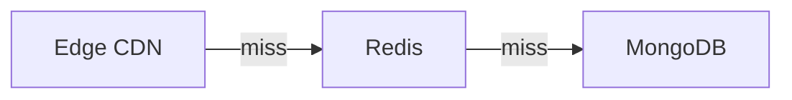

# Documentação do Blog

O sistema de blog do **cotoo.dev** é uma plataforma leve, estática e serverless, desenvolvida sem frameworks adicionais. Ele renderiza arquivos Markdown dinamicamente com suporte a metadados, callouts estilizados, blocos de código com cópia interativa e transição pixelada de temas.

---

## 1. Como Criar uma Nova Postagem

Para publicar um novo post, basta adicionar um arquivo `.md` dentro do diretório `/blog/`.

Exemplo: `blog/meu-novo-artigo.md`

### Estrutura do Arquivo

Todo post deve iniciar obrigatoriamente com o bloco de **Frontmatter YAML**:

```markdown
---
title: Título Completo do Artigo
shortTitle: Título Curto (opcional para a home)
description: Breve resumo do conteúdo para os cards e meta tags de SEO.
date: 2026-10-12
tags: Docker, DevOps, Linux
slug: meu-novo-artigo
---

# Título do Artigo

Escreva o conteúdo normalmente utilizando Markdown...
```

---

## 2. Campos do Frontmatter

| Campo | Obrigatório | Descrição |
| :--- | :---: | :--- |
| `title` | **Sim** | Título principal da publicação. |
| `description` | **Sim** | Resumo exibido na listagem de posts e nas tags Open Graph / SEO. |
| `date` | **Sim** | Data no formato `YYYY-MM-DD`. Usada para ordenação cronológica decrescente. |
| `tags` | Não | Lista de tags separadas por vírgula (ex: `Docker, Linux`). |
| `slug` | Não | Identificador da URL (ex: `slug: meu-post` gerará `/blog/meu-post/`). Se omitido, o nome do arquivo sem `.md` será usado automaticamente. |
| `shortTitle` | Não | Título reduzido usado opcionalmente no card da página inicial. |

---

## 3. Recursos de Markdown Suportados

### 3.1. Callouts / Alertas (GitHub Flavored Markdown)
O blog suporta os 5 tipos de alertas com ícones pixel art e cores temáticas:

```markdown
> [!NOTE]
> Informações úteis ou contexto adicional.

> [!TIP]
> Dicas práticas e boas práticas recomendadas.

> [!IMPORTANT]
> Avisos essenciais e passos obrigatórios.

> [!WARNING]
> Alertas de compatibilidade ou pontos de atenção.

> [!CAUTION]
> Ações de alto risco que podem causar falhas ou perda de dados.
```

### 3.2. Blocos de Código com Botão de Cópia
Blocos de código delimitados por três crases (` ``` `) exibem a linguagem no topo e incluem um botão retrô interativo com ícone pixel art que copia o conteúdo para a área de transferência:

````markdown
```bash
# Comentários são destacados automaticamente
docker run -d -p 80:80 nginx:alpine
```
````

### 3.3. Tabelas, Listas e Formatação Padrão
Tabelas GFM são renderizadas dentro de contêineres responsivos com barras de rolagem estilizadas:

```markdown
| Comando | Descrição |
| :--- | :--- |
| `docker ps` | Lista os containers ativos |
| `docker stop` | Interrompe um container |
```

### 3.4. Diagramas Mermaid
Blocos ```` ```mermaid ```` são renderizados como diagramas no navegador (flowchart, sequence, etc.). A biblioteca é carregada do CDN apenas nos posts que têm diagramas, e cada diagrama só é desenhado quando se aproxima da viewport. As cores seguem o tema (dark/light) via variáveis CSS e a fonte segue o modo Pixel/Leitura.

Uma linha `%% title: Texto` define o título exibido no cabeçalho (ela também é um comentário válido em Mermaid). O botão **código** alterna entre o diagrama e o texto-fonte, que também serve de fallback sem JavaScript ou se a renderização falhar.

````markdown

````

**Interações.** Com o diagrama desenhado, o cabeçalho ganha o botão **expandir**. Ele abre uma janela com uma cópia do diagrama: roda do mouse ou pinça para ampliar, arrastar para mover, botões `-`, `+` e `1:1` (ajustar), teclas `+`, `-`, `0` e `Esc`, e duplo clique para ajustar. Nos fluxogramas, passar o mouse (ou tocar) num nó acende o nó, suas setas, os nós vizinhos e os rótulos das setas, e escurece o resto (o Mermaid 11 nomeia as arestas `L_<origem>_<destino>_<n>`, e é por isso que o script as liga aos nós; diagramas de sequência não têm esse destaque).

A janela entra na troca de tema como o terminal: fundo e borda em duas camadas recortadas pela onda (`.mermaid-zoom` está na lista `stickies` de `blog.js`). O diagrama dentro dela é uma folha só (`.mermaid-zoom-stage`), então vira de uma vez quando a onda passa pelo centro da janela, como os blocos de diagrama do post. A tela escurecida atrás é neutra (preto translúcido) e não precisa virar.

> Dica: coloque os textos dos nós entre aspas (`A["texto (com parênteses)"]`) para evitar erros de sintaxe.

Arquivos envolvidos: `renderMermaidBlock` em [api/blog.js](file:///var/home/gabrielcoto/cotoo.dev/api/blog.js), [assets/js/mermaid-block.js](file:///var/home/gabrielcoto/cotoo.dev/assets/js/mermaid-block.js) e a seção "Mermaid" de [assets/css/blog.css](file:///var/home/gabrielcoto/cotoo.dev/assets/css/blog.css).

### 3.5. Navegação de Leitura (Sumário e Títulos Fixos)
Nos posts, os `##` e `###` ficam fixos abaixo do cabeçalho enquanto a seção correspondente está na tela, e o próximo título empurra o anterior. O `###` empilha logo abaixo do `##`. No mobile (≤ 600px) apenas o `##` fica fixo.

Em telas ≥ 1200px, um sumário `// nesta página` aparece à direita do artigo, com o item ativo destacado conforme a rolagem. Ele só é criado quando o post tem 3 títulos ou mais. Em telas menores, fica oculto.

Tudo é montado no navegador a partir do HTML do post (o HTML servido aos bots não muda). O script agrupa cada título com o conteúdo seguinte em `<section class="post-section">` e `<div class="post-subsection">`, o que limita o `position: sticky` à própria seção. O destaque do sumário usa `IntersectionObserver`.

Arquivos envolvidos: [assets/js/post-toc.js](file:///var/home/gabrielcoto/cotoo.dev/assets/js/post-toc.js) e as seções "Stacking sticky headings" e "Table of contents" de [assets/css/blog.css](file:///var/home/gabrielcoto/cotoo.dev/assets/css/blog.css).

### 3.6. Busca no Índice
A página `/blog/` tem um campo `// buscar` que filtra os cards enquanto você digita. A busca ignora acentos e maiúsculas e exige que todas as palavras apareçam no **título, descrição ou tags** do post (o corpo não entra). O termo vai para a URL (`/blog/?q=docker`), a tecla `/` foca o campo e `Esc` limpa.

Cada `<li>` do índice carrega o texto pesquisável em `data-search`, então não há API nem índice extra. O campo nasce oculto e só aparece quando o script carrega, para não mostrar um campo que não funciona sem JavaScript.

Animações (desligadas com `prefers-reduced-motion`): os cards entram em cascata ao abrir o índice; ao filtrar, os que ficam deslizam para a nova posição e os que reaparecem entram com fade; a mensagem de vazio surge suavemente e o campo ganha uma sombra ao focar.

Arquivos envolvidos: `renderIndexHtml` em [api/blog.js](file:///var/home/gabrielcoto/cotoo.dev/api/blog.js), [assets/js/post-search.js](file:///var/home/gabrielcoto/cotoo.dev/assets/js/post-search.js) e a seção "Index search" de [assets/css/blog.css](file:///var/home/gabrielcoto/cotoo.dev/assets/css/blog.css).

### 3.7. Animações dos Posts
Os posts têm duas animações suaves, ambas com `opacity`/`transform` e desligadas com `prefers-reduced-motion`:

- **Barra de progresso de leitura:** linha fina sobre a borda do header (`.reading-progress`).
- **Sumário:** entra deslizando e o item ativo muda de cor com transição.

Arquivos envolvidos: [assets/js/post-motion.js](file:///var/home/gabrielcoto/cotoo.dev/assets/js/post-motion.js) e a seção "Reading progress bar" de [assets/css/blog.css](file:///var/home/gabrielcoto/cotoo.dev/assets/css/blog.css).

### 3.8. Tags e Posts Relacionados
As tags no topo do post são links para a página da tag, `/blog/tag/<tag>/`, que lista os posts com ela (mais novos primeiro). O endereço usa a tag em minúsculas, sem acentos e com hífens (`Docker Compose` vira `docker-compose`, `Segurança` vira `seguranca`; `tagSlug` em `api/blog.js`). `/blog/tag/` lista todas as tags com a contagem de posts, e o índice do blog tem um link `#tags` ao lado do RSS. A busca `/blog/?q=<termo>` continua funcionando.

- **Rotas:** `vercel.json` reescreve `/blog/tag[/]` para `/api/blog?page=tags` e `/blog/tag/:tag[/]` para `/api/blog?tag=:tag`.
- **Validação:** o parâmetro passa por `tagSlug` (só `a-z`, `0-9` e hífens, até 60 caracteres na entrada). Tag vazia redireciona (302) para `/blog/tag/`; uma variação de uma tag existente (`/blog/tag/Docker`, `/blog/tag/Seguran%C3%A7a`) redireciona (301) para o endereço canônico; qualquer outra coisa recebe a página 404, sem repetir o que foi digitado.
- **SEO:** cada página tem `canonical`, Open Graph e JSON-LD `CollectionPage`, e entra no `sitemap.xml` (que é estático: ao criar um post com uma tag nova, adicione `/blog/tag/<tag>/` lá também). No fim de cada post, o bloco `// continue lendo` mostra até 2 outros posts: primeiro os que têm mais tags em comum e, se faltar, os mais recentes. O tempo de leitura (palavras ÷ 200, sem contar blocos de código) aparece no cabeçalho do post e nos cards.

Como os relacionados dependem da pasta inteira, o cache de cada post guarda também a assinatura de `/blog/` e é refeito quando qualquer post muda. Arquivos envolvidos: `pickRelated` e `renderRelatedHtml` em [api/blog.js](file:///var/home/gabrielcoto/cotoo.dev/api/blog.js) e a seção "Related posts" de [assets/css/blog.css](file:///var/home/gabrielcoto/cotoo.dev/assets/css/blog.css).

### 3.9. Página /now
`/now/` mostra o que o Gabriel está fazendo agora. O texto vem de [blog/_now.md](file:///var/home/gabrielcoto/cotoo.dev/blog/_now.md) (o prefixo `_` o tira da lista de posts): edite o Markdown e atualize o campo `date`, que aparece como "atualizado em". Abaixo do texto, o bloco `// ao vivo` é preenchido no navegador por [assets/js/now.js](file:///var/home/gabrielcoto/cotoo.dev/assets/js/now.js) com a música tocando (`/api/spotify`) e o último commit (`/api/github`); cada linha só aparece se a API responder.

A rota é reescrita para `/api/blog?page=now` e a página reaproveita o layout do blog, incluindo a troca de tema.

---

## 4. Arquitetura e Funcionamento

- **Roteamento ([vercel.json](file:///var/home/gabrielcoto/cotoo.dev/vercel.json)):**
  - `/blog/` e `/blog/:slug/` são roteados automaticamente para a serverless function em `api/blog.js`.
- **Renderizador ([api/blog.js](file:///var/home/gabrielcoto/cotoo.dev/api/blog.js)):**
  - Lê dinamicamente os arquivos da pasta `/blog/`.
  - Converte Markdown para HTML em tempo de execução via `marked`.
  - Cache em múltiplas camadas:
    - **Tier 1 (Memória):** Resposta em `< 0.1ms`.
    - **Tier 2 (Upstash Redis):** Persistência na borda (Edge).
    - **Fallback:** Releitura do disco se o arquivo for modificado.
- **Forçar Atualização de Cache:**
  - Adicione o parâmetro `?refresh=1` na URL para invalidar o cache e forçar a releitura imediata do disco (ex: `/blog/meu-post/?refresh=1`).
- **Feed RSS:**
  - `/blog/rss.xml` é reescrito para `/api/blog?format=rss` e lista todos os posts (título, descrição, data e tags). Cada página do blog anuncia o feed com `<link rel="alternate">`. O feed também aparece como botão (`.rss-link`, com ícone em pixel art): no cabeçalho do índice e no fim de cada post, depois dos relacionados (`renderFeedLink` em `api/blog.js`). A borda dele está na lista `borderColor` de `blog.js`, então vira com a onda do tema.
- **Sitemap:**
  - Lembre-se de adicionar a nova rota em `sitemap.xml` para indexação em motores de busca.
