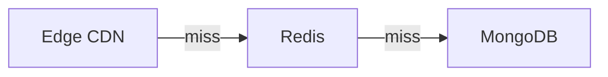

# Documentação do Blog

O sistema de blog do **cotoo.dev** é uma plataforma leve, estática e serverless, desenvolvida sem frameworks adicionais. Ele renderiza arquivos Markdown dinamicamente com suporte a metadados, callouts estilizados, blocos de código com cópia interativa e transição pixelada de temas.

---

## 1. Como Criar uma Nova Postagem

Para publicar um novo post, basta adicionar um arquivo `.md` dentro do diretório `/blog/`.

Exemplo: `blog/meu-novo-artigo.md`

### Estrutura do Arquivo

Todo post deve iniciar obrigatoriamente com o bloco de **Frontmatter YAML**:

```markdown
---
title: Título Completo do Artigo
shortTitle: Título Curto (opcional para a home)
description: Breve resumo do conteúdo para os cards e meta tags de SEO.
date: 2026-10-12
tags: Docker, DevOps, Linux
slug: meu-novo-artigo
---

# Título do Artigo

Escreva o conteúdo normalmente utilizando Markdown...
```

---

## 2. Campos do Frontmatter

| Campo | Obrigatório | Descrição |
| :--- | :---: | :--- |
| `title` | **Sim** | Título principal da publicação. |
| `description` | **Sim** | Resumo exibido na listagem de posts e nas tags Open Graph / SEO. |
| `date` | **Sim** | Data no formato `YYYY-MM-DD`. Usada para ordenação cronológica decrescente. |
| `tags` | Não | Lista de tags separadas por vírgula (ex: `Docker, Linux`). |
| `slug` | Não | Identificador da URL (ex: `slug: meu-post` gerará `/blog/meu-post/`). Se omitido, o nome do arquivo sem `.md` será usado automaticamente. |
| `shortTitle` | Não | Título reduzido usado opcionalmente no card da página inicial. |

---

## 3. Recursos de Markdown Suportados

### 3.1. Callouts / Alertas (GitHub Flavored Markdown)
O blog suporta os 5 tipos de alertas com ícones pixel art e cores temáticas:

```markdown
> [!NOTE]
> Informações úteis ou contexto adicional.

> [!TIP]
> Dicas práticas e boas práticas recomendadas.

> [!IMPORTANT]
> Avisos essenciais e passos obrigatórios.

> [!WARNING]
> Alertas de compatibilidade ou pontos de atenção.

> [!CAUTION]
> Ações de alto risco que podem causar falhas ou perda de dados.
```

### 3.2. Blocos de Código com Botão de Cópia
Blocos de código delimitados por três crases (` ``` `) exibem a linguagem no topo e incluem um botão retrô interativo com ícone pixel art que copia o conteúdo para a área de transferência:

````markdown
```bash
# Comentários são destacados automaticamente
docker run -d -p 80:80 nginx:alpine
```
````

### 3.3. Tabelas, Listas e Formatação Padrão
Tabelas GFM são renderizadas dentro de contêineres responsivos com barras de rolagem estilizadas:

```markdown
| Comando | Descrição |
| :--- | :--- |
| `docker ps` | Lista os containers ativos |
| `docker stop` | Interrompe um container |
```

### 3.4. Diagramas Mermaid
Blocos ```` ```mermaid ```` são renderizados como diagramas no navegador (flowchart, sequence, etc.). A biblioteca é carregada do CDN apenas nos posts que têm diagramas, e cada diagrama só é desenhado quando se aproxima da viewport. As cores seguem o tema (dark/light) via variáveis CSS e a fonte segue o modo Pixel/Leitura.

Uma linha `%% title: Texto` define o título exibido no cabeçalho (ela também é um comentário válido em Mermaid). O botão **código** alterna entre o diagrama e o texto-fonte, que também serve de fallback sem JavaScript ou se a renderização falhar.

````markdown

````

> Dica: coloque os textos dos nós entre aspas (`A["texto (com parênteses)"]`) para evitar erros de sintaxe.

Arquivos envolvidos: `renderMermaidBlock` em [api/blog.js](file:///var/home/gabrielcoto/cotoo.dev/api/blog.js), [assets/js/mermaid-block.js](file:///var/home/gabrielcoto/cotoo.dev/assets/js/mermaid-block.js) e a seção "Mermaid" de [assets/css/blog.css](file:///var/home/gabrielcoto/cotoo.dev/assets/css/blog.css).

### 3.5. Navegação de Leitura (Sumário e Títulos Fixos)
Nos posts, os `##` e `###` ficam fixos abaixo do cabeçalho enquanto a seção correspondente está na tela, e o próximo título empurra o anterior. O `###` empilha logo abaixo do `##`. No mobile (≤ 600px) apenas o `##` fica fixo.

Em telas ≥ 1200px, um sumário `// nesta página` aparece à direita do artigo, com o item ativo destacado conforme a rolagem. Ele só é criado quando o post tem 3 títulos ou mais. Em telas menores, fica oculto.

Tudo é montado no navegador a partir do HTML do post (o HTML servido aos bots não muda). O script agrupa cada título com o conteúdo seguinte em `<section class="post-section">` e `<div class="post-subsection">`, o que limita o `position: sticky` à própria seção. O destaque do sumário usa `IntersectionObserver`.

Arquivos envolvidos: [assets/js/post-toc.js](file:///var/home/gabrielcoto/cotoo.dev/assets/js/post-toc.js) e as seções "Stacking sticky headings" e "Table of contents" de [assets/css/blog.css](file:///var/home/gabrielcoto/cotoo.dev/assets/css/blog.css).

---

## 4. Arquitetura e Funcionamento

- **Roteamento ([vercel.json](file:///var/home/gabrielcoto/cotoo.dev/vercel.json)):**
  - `/blog/` e `/blog/:slug/` são roteados automaticamente para a serverless function em `api/blog.js`.
- **Renderizador ([api/blog.js](file:///var/home/gabrielcoto/cotoo.dev/api/blog.js)):**
  - Lê dinamicamente os arquivos da pasta `/blog/`.
  - Converte Markdown para HTML em tempo de execução via `marked`.
  - Cache em múltiplas camadas:
    - **Tier 1 (Memória):** Resposta em `< 0.1ms`.
    - **Tier 2 (Upstash Redis):** Persistência na borda (Edge).
    - **Fallback:** Releitura do disco se o arquivo for modificado.
- **Forçar Atualização de Cache:**
  - Adicione o parâmetro `?refresh=1` na URL para invalidar o cache e forçar a releitura imediata do disco (ex: `/blog/meu-post/?refresh=1`).
- **Sitemap:**
  - Lembre-se de adicionar a nova rota em `sitemap.xml` para indexação em motores de busca.
